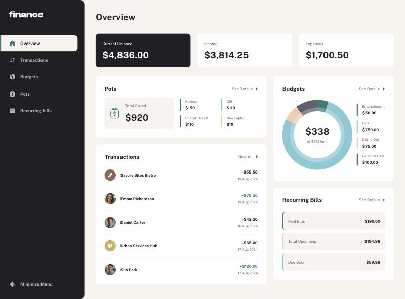

# Frontend Mentor - Personal finance app



## Table of contents

- [Overview](#overview)
  - [The challenge](#the-challenge)
  - [Links](#links)
- [My process](#my-process)
  - [Built with](#built-with)
  - [What I learned](#what-i-learned)
- [Author](#author)

## Overview

### The challenge

Your challenge is to build out this personal finance app and get it looking as close to the design as possible. The app has seven pages: Sign Up, Login, Overview, Transactions, Budgets, Pots and Recurring Bills, with mobile, tablet and desktop layouts, dropdown menus, modals and the hover, active and error states from the Figma design system.

You can use any tools you like to help you complete the challenge. So if you've got something you'd like to practice, feel free to give it a go.

Your users should be able to:

- Create an account and log in. Every field is required, and an empty field shows a red border with "Can't be empty"
- See all of the personal finance app data at-a-glance on the overview page
- View all transactions on the transactions page with pagination for every ten transactions
- Search transactions by recipient/sender, category, transaction date and amount
- Sort transactions (Latest, Oldest, A to Z, Z to A, Highest, Lowest) and filter them by category
- Add new transactions with a recipient/sender, category, date (calendar) and a positive or negative amount
- Create, read, update and delete (CRUD) budgets and savings pots, from the "..." menu on each card
- See which theme colors are already used by another budget or pot
- View the latest three transactions for each budget category created
- View progress towards each pot
- Add money to and withdraw money from pots
- View recurring bills and the status of each for the current month
- Search recurring bills by title, due date and amount, and sort them
- Add, edit and delete recurring bills (title, due date from a calendar, amount)
- Receive validation messages if required form fields aren't completed
- Navigate the whole app and perform all actions using only their keyboard
- View the optimal layout for the interface depending on their device's screen size
- See hover and focus states for all interactive elements on the page

#### Expected behaviour

- Overview
  - This page displays all the information at-a-glance and allows for easy navigation.
- Transactions
  - The transactions from the `data.json` file are paginated for every ten transactions.
  - The search matches the recipient/sender name, category, transaction date and amount.
  - The sorting options include: Latest (most recent), Oldest, A to Z, Z to A, Highest (transaction amount), Lowest.
  - The filter is by transaction category, which are: Entertainment, Bills, Groceries, Dining Out, Transportation, Personal Care, Education, Lifestyle, Shopping, General. Filtering by category only shows transactions from the selected category.
- Budgets
  - The "Spent" amount is the money spent within the category for the current month (August 2024 in the app).
  - The "Latest Spending" component displays the three last transactions for that category regardless of the month.
  - Clicking "See All" on a budget navigates to the Transactions page with the filter set to the relevant category.
  - Adding a new budget automatically pulls in the three latest transactions from the created budget category and calculates the amount spent so far for August 2024.
  - Deleting a budget removes it from the Budgets page and the Overview.
- Pots
  - Adding money to a pot deducts the given amount from the current balance (seen on the Overview page).
  - Withdrawing money from a pot adds that amount to the current balance.
  - Deleting a pot returns all the money from the pot to the current balance.
- Recurring Bills
  - Only one item is shown per vendor.
  - Bills already paid in August 2024 are marked as paid.
  - Bills due within five days of the latest overall transaction in the app (Emma Richardson - 19 August 2024) and not yet paid are marked as due soon.
  - The sorting options include: Latest (earliest in the month), Oldest, A to Z, Z to A, Highest (transaction amount), Lowest.

### Links

- Live Site URL: [github pages](https://gerardocianciulli.github.io/personal-finance-app/)

## My process

### Built with

- Semantic HTML5 markup
- CSS custom properties
- Flexbox
- CSS Grid
- Media Queries
- CSS units in rem
- React
- Typescript
- Vite
- vite-plugin-svgr
- React Router
- Formik
- Yup
- jQuery
- Fetch API
- json-server
- gh-pages

### What I learned

#### Letting jQuery and React share the same markup

React renders the dropdowns, modals and menus, while jQuery drives the interactions (slide and fade animations, outside clicks, keyboard navigation). Each behavior lives in a custom hook that attaches namespaced jQuery events in `useEffect` and removes them on unmount, so React's Strict Mode and route changes never leave stray handlers behind.

```ts
export function useDropdown(rootRef: RefObject<HTMLElement | null>, onSelect: (value: string) => void) {
  const onSelectRef = useLatest(onSelect)

  useEffect(() => {
    const ns = nextNamespace('dropdown')
    const $root = $(rootRef.current!)
    const $menu = $root.find('[data-dropdown-menu]').first()

    $root.find('[data-dropdown-trigger]').on(`click${ns}`, () => $menu.stop(true, true).slideToggle(150))
    $menu.on(`click${ns}`, '[data-dropdown-option]', function (this: HTMLElement) {
      onSelectRef.current($(this).attr('data-value') ?? '')
    })

    return () => $root.find('*').addBack().off(ns)
  }, [rootRef, onSelectRef])
}
```

One lesson came from the password visibility toggle: React re-applies an input's `type` every time it re-renders, so a `type` changed by jQuery was reset as soon as Formik updated the form. jQuery still handles the toggle button, but it reports the new state back to React, which owns the `type`.

#### Validating forms with Formik and Yup

Every form is a Formik form with a Yup schema. Required fields show "Can't be empty", and the sign up rules check that the name has two to four words, the email looks like `name@domain.suffix`, and the password has at least eight characters with an uppercase letter, a lowercase letter and a special character.

```ts
export const signUpSchema = Yup.object({
  name: Yup.string()
    .trim()
    .required("Can't be empty")
    .test('min-words', 'Enter at least two words', (value) => countWords(value) >= 2)
    .test('max-words', 'Use fewer than five words', (value) => countWords(value) < 5),
  email: Yup.string().trim().required("Can't be empty").matches(EMAIL_PATTERN, 'Enter a valid email, e.g. name@domain.com'),
  password: Yup.string()
    .required("Can't be empty")
    .min(8, 'Passwords must be at least 8 characters')
    .matches(/[A-Z]/, 'Include an uppercase letter')
    .matches(/[a-z]/, 'Include a lowercase letter')
    .matches(/[^A-Za-z0-9\s]/, 'Include a special character'),
})
```

#### SVG icons as React components

With `vite-plugin-svgr`, the icons from the assets folder are imported as components. The icons ship with a fixed fill color, so CSS sets `fill: currentColor` and the sidebar's hover and active states only change `color`.

```tsx
import IconNavOverview from '../assets/images/icon-nav-overview.svg?react'

<span className="sidebar__icon" aria-hidden="true">
  <IconNavOverview />
</span>
```

#### One data layer for json-server and GitHub Pages

The data is read and written with Fetch through json-server during development. GitHub Pages can't run json-server, so the app falls back to a store in `localStorage` that is seeded from the same `data.json` file. Both stores share one interface, so the pages never know which one they are using.

```bash
npm install
npm run dev      # json-server on http://localhost:3001 + Vite on http://localhost:5173/personal-finance-app/
npm run seed     # reset db.json to the sample data
npm run deploy   # build and publish the dist folder to GitHub Pages
```

## Author

- Portfolio - [Gerardo Cianciulli](https://www.behance.net/gerardo-cianciulli)
- Frontend Mentor - [Gerardo Cianciulli](https://www.frontendmentor.io/profile/GerardoCianciulli)
- Linkedin - [Gerardo Cianciulli](https://www.linkedin.com/in/gerardo-cianciulli/)
